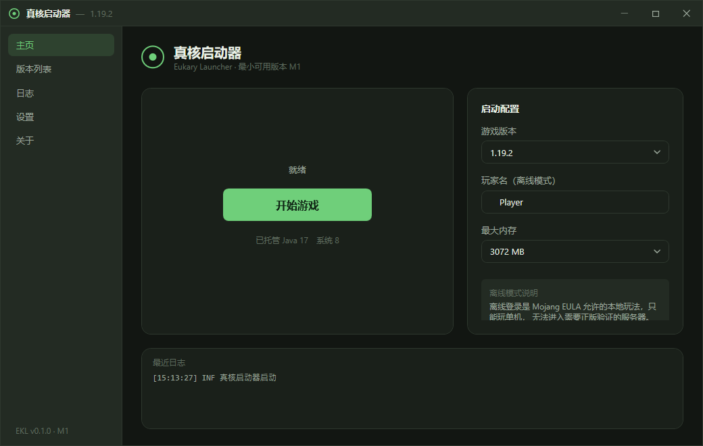

# 真核启动器 · Eukary Launcher (EKL)

[](https://github.com/EukaryDeveloper/Eukary-Launcher/actions/workflows/build.yml)
[](LICENSE)
[](https://dotnet.microsoft.com/)
[](https://github.com/EukaryDeveloper/Eukary-Launcher)
[](CONTRIBUTING.md)

用 C# 写的开源 Minecraft Java 版第三方启动器。核心轻量稳定，插件如同细胞器自由挂载。

> **免责声明**：本启动器与 Microsoft / Mojang 无任何关联。Minecraft 是 Mojang Synergies AB 的商标。
> 本启动器不打包、不分发任何 Minecraft 游戏文件，所有游戏内容在用户本地运行时从官方源或 BMCLAPI 镜像下载。



---

## 下载与安装

从 [Releases](https://github.com/EukaryDeveloper/Eukary-Launcher/releases) 下载安装包双击安装即可；
也可以拉下源码自己跑（见下方「构建与运行」）。

- 安装包自包含单文件，**不需要预先安装 .NET 运行时**
- 按用户安装到 `%LOCALAPPDATA%\Programs\Eukary Launcher`，**不需要管理员权限**
- 卸载从开始菜单或「应用和功能」，已下载的游戏文件和 Java 运行时可选择保留

---

## 当前进度：M1 最小可用启动器 ✅

| M1 验收项 | 状态 |
|---|---|
| 拉版本清单，列出所有 release 版本 | ✅ |
| 选一个版本，完整下载 libraries + assets + jar | ✅ |
| 离线输入用户名，拼命令行，启动游戏 | ✅ |
| 界面实时显示游戏日志 | ✅ |
| **验收标准：点一下就能玩上原版 1.20.4** | ✅ 已由 `ekl-smoke --launch 1.20.4` 端到端验证 |

实测数据（本机 Windows 10 + BMCLAPI 镜像）：
- libraries 64 个、assets 3788 个唯一哈希（626 MB）、主 jar 24.4 MB，全部 SHA1 校验通过
- Java 17 JRE 由 Adoptium 自动下载并解压到 `runtime/java-17/`
- 游戏进程真实启动到主菜单，日志无 `ClassNotFoundException` / `NoClassDefFoundError` / `no lwjgl in java.library.path`
- 离线模式下出现 `InvalidCredentialsException: 401` 属预期（假 token 无法取正版 user properties），不影响单机游玩

---

## 技术选型

| 项 | 选择 | 理由 |
|---|---|---|
| UI 框架 | **WPF** | 只服务 Windows（最低 Win10），生态最成熟，PCL2 同款路线 |
| 运行时 | **.NET 8 (LTS)** | 自包含单文件发布，用户不用装 .NET |
| MVVM | CommunityToolkit.Mvvm | 微软官方源生成器，代码量少 |
| JSON | System.Text.Json | 官方，性能好 |
| 日志 | 自研 `LogService` | 现阶段不需要 Serilog 的结构化能力，避免多余依赖 |
| 协议 | GPL-3.0 | 与 PCL2 / HMCL 一致，启动器圈事实标准 |

**最低系统要求**：Windows 10 1607+（.NET 8 Windows 桌面运行时要求）。

---

## 工程结构

```
EukaryLauncher.sln
├── EukaryLauncher.Core/       ← 类库，零 UI 依赖，可单独做单元测试
│   ├── Models/                ← 版本清单 / 版本 JSON / 启动参数 DTO
│   │                             （含 arguments 多态 JSON 转换器、离线 UUID）
│   └── Services/
│       ├── VersionInstaller   ← 下载 libraries/assets/jar、解压 natives、继承合并
│       ├── VersionMerger      ← inheritsFrom 深度合并
│       ├── RuleEvaluator      ← rules 求值（os / arch / features）
│       ├── DownloadService    ← 多线程 + SHA1 校验 + 重试 + 断点续传
│       ├── MirrorService      ← 官方源 / BMCLAPI 可切换
│       ├── JavaManager        ← Adoptium API 自动下载 JRE
│       ├── ArgumentBuilder    ← JVM / 游戏参数拼接
│       └── GameLauncher       ← 进程启动与日志转发
├── EukaryLauncher.App/        ← WPF UI 层
│   ├── Themes/Tokens.xaml     ← 设计令牌（唯一真源）
│   ├── Themes/Controls.xaml   ← 全部控件样式
│   ├── Animation/             ← cubic-bezier(0.2,0.8,0.2,1) 缓动实现
│   ├── Views/  ViewModels/  Services/  Converters/
├── EukaryLauncher.Smoke/      ← 冒烟测试（纯逻辑断言 + 端到端下载/启动）
└── docs/                      ← 文档资源
```

---

## 构建与运行

```bash
# 纯逻辑断言（不需要网络，秒级）
dotnet run --project EukaryLauncher.Smoke

# 真实下载一个版本
dotnet run --project EukaryLauncher.Smoke -- --install 1.20.4

# 端到端：装完再启动，抓 90 秒日志后结束进程
dotnet run --project EukaryLauncher.Smoke -- --launch 1.20.4

# 发布自包含单文件
dotnet publish EukaryLauncher.App -c Release -r win-x64 --self-contained -p:PublishSingleFile=true
```

---

## UI 规范落地情况

严格按《UI 设计图纸》实现：

- **设计令牌唯一真源**：`Themes/Tokens.xaml` 定义全部颜色 / 圆角 / 字号 / 间距 / 时长，控件里零硬编码色值。换主题只需换这一份字典。
- **统一动效曲线**：WPF 没有内置 `cubic-bezier(0.2,0.8,0.2,1)`，自写了 `CubicBezierEase`（牛顿迭代解贝塞尔参数），全站共用。
- **动效时长三档**：120ms 微交互 / 200ms 页面切换 / 300ms 弹窗。
- **去系统边框**：`WindowChrome` + 自绘标题栏（Logo 左、最小化/最大化/关闭右），启动 200ms 淡入 + Y 8→0，关闭 150ms 淡出 + 缩放到 0.98。
- **无障碍**：读注册表 `MinAnimate`，系统关闭动画时全部动效降为 0。
- **4px 栅格**：所有间距 token 落在 4/8/12/16/24/32。
- **Logo**：自绘真核细胞意象（外膜 + 核仁），不使用任何 Minecraft 素材。

---

## 与开发指南的两处已知偏差（有意为之）

1. **没上 Serilog**。M1 只需要"内存缓冲 + 落盘文件"，自研 20 行 `LogService` 就够，等 M8 插件系统需要按插件分日志时再换。
2. **没开 ILTrimming / NativeAOT**。指南里这条对 WPF 不适用（`NETSDK1168: 启用剪裁时不支持 WPF`）。改用 `self-contained + PublishSingleFile + EnableCompressionInSingleFile` 控制体积。

另外，**指南 M5 的 Java 自动下载被提前到了 M1**——没有 Java 就点不动游戏，与其让用户卡住不如直接做掉。

---

## 后续里程碑

- **M2** 微软账号登录（OAuth + PKCE → XBL → XSTS → MC token）
- **M3** Fabric 支持 + Modrinth 模组下载
- **M4** 整合包导入导出（mrpack / CurseForge zip）
- **M5** NeoForge + 老 Forge 兼容
- **M6** 主题系统 + 资源包 / 光影 / 数据包
- **M7** 发布与自动更新
- **M8** 插件系统与插件市场（`AssemblyLoadContext` 隔离加载）

---

## 参与开发

欢迎提 Issue、改进文档、写代码。开工前请读：

- 📘 [CONTRIBUTING.md](CONTRIBUTING.md) —— 分支规范、提交格式、代码约定、自测要求
- 🔒 [SECURITY.md](SECURITY.md) —— 漏洞报告走私密通报，不要在公开 Issue 里发

想在动手前先聊聊？来 [Discussions](https://github.com/EukaryDeveloper/Eukary-Launcher/discussions)。

一个简单的 PR 流程：

```bash
git clone https://github.com/EukaryDeveloper/Eukary-Launcher.git
cd Eukary-Launcher
git switch -c feat/m2-msa-login
# 改代码
dotnet run --project EukaryLauncher.Smoke       # 必跑，秒级
git commit -m "feat(core): 实现微软登录的 XBL 换票"
git push -u origin feat/m2-msa-login
# 然后到 GitHub 上开 PR
```

---

## 合规红线（必须遵守）

- ❌ 不打包 / 分发 Minecraft 游戏本体文件
- ❌ 不使用 Minecraft 官方 Logo、Steve / Alex 作为品牌标识
- ❌ 不做"破解登录"，不伪造正版会话去登正版服务器
- ❌ 不做付费墙、订阅、强制打赏
- ✅ 微软登录必须自己申请 Azure 应用，**不抄 PCL2 / HMCL 的 Client ID**
- ✅ 下载源可配置，默认 BMCLAPI，官方源兜底
- ✅ 关于页放置免责声明与资源来源标注

---

## 许可证

本项目以 [GPL-3.0](LICENSE) 授权发布，与 PCL2 / HMCL 保持一致。

```
Copyright (C) 2026 DL_Hachi

This program is free software: you can redistribute it and/or modify
it under the terms of the GNU General Public License as published by
the Free Software Foundation, either version 3 of the License, or
(at your option) any later version.

This program is distributed in the hope that it will be useful,
but WITHOUT ANY WARRANTY; without even the implied warranty of
MERCHANTABILITY or FITNESS FOR A PARTICULAR PURPOSE. See the
GNU General Public License for more details.
```

Minecraft 是 Mojang Synergies AB 的商标，本项目不为商标权利人所有、亦未经其认可。
