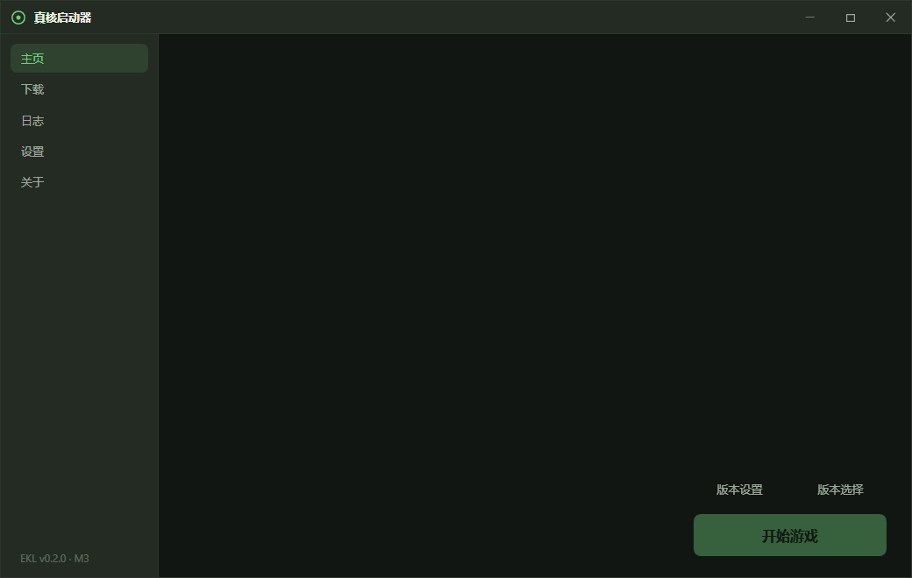
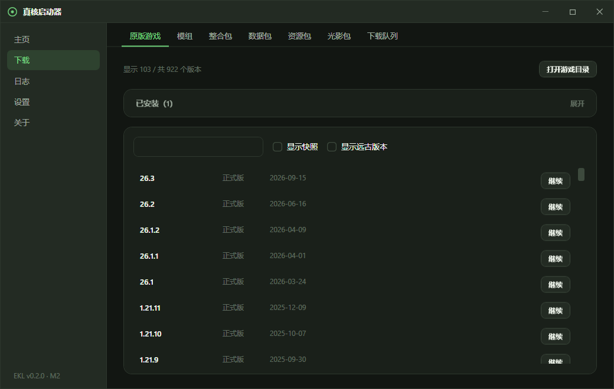

# 真核启动器 · Eukary Launcher (EKL)

[](https://github.com/EukaryDeveloper/Eukary-Launcher/actions/workflows/build.yml)
[](LICENSE)
[](https://dotnet.microsoft.com/)
[](https://github.com/EukaryDeveloper/Eukary-Launcher)
[](CONTRIBUTING.md)

用 C# 写的开源 Minecraft Java 版第三方启动器。核心轻量稳定，插件如同细胞器自由挂载。

> **免责声明**：本启动器与 Microsoft / Mojang 无任何关联。Minecraft 是 Mojang Synergies AB 的商标。
> 本启动器不打包、不分发任何 Minecraft 游戏文件，所有游戏内容在用户本地运行时从官方源或 BMCLAPI 镜像下载。





---

## 下载与安装

从 [Releases](https://github.com/EukaryDeveloper/Eukary-Launcher/releases) 下载最新的
`EukaryLauncher-x.y.z-Setup.exe`，双击安装即可。

- 安装包自包含单文件，**不需要预先安装 .NET 运行时**
- 按用户安装到 `%LOCALAPPDATA%\Programs\Eukary Launcher`，**不需要管理员权限**
- 卸载从开始菜单或「应用和功能」，已下载的游戏文件和 Java 运行时可选择保留
- 系统要求：Windows 10 1607 及以上、64 位

---

## 功能总览

### 游戏安装与启动

- 支持安装 Mojang 官方全部版本：正式版、快照、远古 alpha / beta 都能下载游玩
- Fabric / Forge / NeoForge / OptiFine 四种模组加载器，能共存的可以组合安装
- 内置 Modrinth 模组搜索与安装，可按游戏版本和加载器筛选，安装前自动校验兼容性
- 远古版本（1.1 等）同样能装能玩
- Java 全自动：缺哪个版本就自动下载哪个，不需要手动安装 Java
- 输入用户名即可离线游玩单机

### 下载管理

- 多任务并发下载，支持暂停、继续、取消和失败重试
- 默认使用国内镜像（BMCLAPI），失败自动回退官方源；支持断点续传
- 下载完成、出错都有通知提醒

### 版本管理

- 多游戏文件夹，文件夹可自定义显示名
- 版本隔离：每个版本有独立的存档、资源包与配置目录，互不干扰（五档策略可调，默认隔离所有版本）
- 版本选择页集中管理已装版本：切换、删除、文件夹改名，空文件夹会引导去下载

### 界面

- 主页一键开始游戏，当前选择的版本与加载器直接显示在按钮上
- 实时滚动显示游戏日志
- 全站统一的流畅动效与信息流布局

---

## 里程碑进度

| 里程碑 | 内容 | 状态 |
|---|---|---|
| M1 | 最小可用：装原版、启动、看日志 | ✅ v0.1.0 |
| M2 | 微软正版登录 | 🚧 进行中（当前阶段） |
| M3 | 下载中心：原版 / 加载器 / 模组 / 队列 | 🟡 主体功能已可用 |
| M4 | 整合包导入与安装 | ⬜ 占位标签 |
| M5 | Forge / NeoForge / OptiFine 安装、Java 自动下载 | ✅ |
| M6 | 主题 | ⬜ |
| M7 | 发布：自动更新、崩溃报告 | ⬜ |
| M8 | 插件系统 | ⬜ |

> 当前只有离线登录可用，微软正版登录尚未接入，因此项目仍处在 M2。

---

## 技术选型

| 项 | 选择 | 理由 |
|---|---|---|
| UI 框架 | **WPF** | 只服务 Windows（最低 Win10），桌面生态最成熟 |
| 运行时 | **.NET 8 (LTS)** | 长期支持版本，自包含单文件发布，用户不用装 .NET |
| MVVM | CommunityToolkit.Mvvm | 微软官方源生成器，代码量少 |
| JSON | System.Text.Json | 官方，性能好 |
| 日志 | 自研 `LogService` | 轻量够用，避免多余依赖 |
| 协议 | GPL-3.0 | 开源 Minecraft 启动器的通行选择 |

**最低系统要求**：Windows 10 1607+（.NET 8 Windows 桌面运行时要求）。

---

## 工程结构

```
EukaryLauncher.sln
├── EukaryLauncher.Core/       ← 类库，零 UI 依赖，可单独做单元测试
│   ├── Models/                ← 版本清单 / 版本 JSON / 启动参数 / Modrinth / 隔离策略
│   └── Services/
│       ├── VersionInstaller   ← 下载 libraries/assets/jar、解压 natives、继承合并
│       ├── VersionMerger      ← inheritsFrom 深度合并
│       ├── RuleEvaluator      ← rules 求值（os / arch / features）
│       ├── DownloadService    ← 多线程 + SHA1 校验 + 重试 + 断点续传 + 备源回退
│       ├── MirrorService      ← 官方源 / BMCLAPI 可切换
│       ├── JavaManager        ← Adoptium API 自动下载 JRE、本机 Java 枚举与版本匹配
│       ├── LoaderService      ← 加载器识别、加载器版本列表、Fabric profile 拉取
│       ├── LoaderMetaService  ← Forge / NeoForge / OptiFine 版本列表与安装器地址
│       ├── OptiFinePatcher    ← 调 optifine.Patcher 产出库
│       ├── ProcessRunner      ← 流式读取安装器输出
│       ├── FolderVersionScanner ← 扫描 versions/ 得到本体版本 + 加载器文本
│       ├── LegacyCompat       ← 老版本 options.txt 兼容处理
│       ├── ArgumentBuilder    ← JVM / 游戏参数拼接
│       └── GameLauncher       ← 进程启动、日志转发、等待游戏窗口出现
├── EukaryLauncher.App/        ← WPF UI 层
│   ├── Themes/Tokens.xaml     ← 设计令牌（唯一真源）
│   ├── Themes/Controls.xaml   ← 全部控件样式
│   ├── Animation/             ← 缓动实现
│   ├── Services/              ← 下载队列、下载任务、设置、通知、模组索引、隔离旗标
│   ├── Views/  ViewModels/
├── EukaryLauncher.Smoke/      ← 冒烟测试（31 条纯逻辑断言 + 端到端下载/启动）
├── tools/                     ← UI 自动化走查脚本（uiautomation）
└── docs/                      ← 文档资源
```

---

## 构建与运行

```bash
git clone https://github.com/EukaryDeveloper/Eukary-Launcher.git
cd Eukary-Launcher

# 纯逻辑断言（不需要网络，秒级）
dotnet run --project EukaryLauncher.Smoke

# 真实下载一个版本
dotnet run --project EukaryLauncher.Smoke -- --install 1.20.4

# 端到端：装完再启动，抓 90 秒日志后结束进程
dotnet run --project EukaryLauncher.Smoke -- --launch 1.20.4

# 直接跑启动器
dotnet run --project EukaryLauncher.App

# 发布自包含单文件
dotnet publish EukaryLauncher.App -c Release -r win-x64 --self-contained -p:PublishSingleFile=true
```

---

## 二次开发

想在这套代码上加功能、改 UI、接新加载器或新下载源，先读
📗 [docs/DEVELOPMENT.md](docs/DEVELOPMENT.md) —— 分层约定、关键数据流、
常见扩展点的改法以及必须绕开的坑。

---

## 已知限制

- **只能离线登录**：填用户名即玩单机，进不了正版服务器（微软登录尚未实现）
- 整合包 / 数据包 / 资源包 / 光影包四个标签页仍是占位
- 主页「版本设置」按钮目前只是占位提示，按版本覆盖内存 / 窗口 / JVM 参数的页面还没做
- 额外游戏文件夹还没有添加入口；非默认文件夹里的版本可以查看和切换选中，
  但启动仍以默认游戏目录为准
- 暂停后继续下载时，进度显示会重新计算（下载内容本身从断点续传，不会重下）

---

## 参与开发

欢迎提 Issue、改进文档、写代码。开工前请读：

- 📘 [CONTRIBUTING.md](CONTRIBUTING.md) —— 分支规范、提交格式、代码约定、自测要求
- 📗 [docs/DEVELOPMENT.md](docs/DEVELOPMENT.md) —— 二次开发指南：分层、扩展点、踩坑清单
- 🔒 [SECURITY.md](SECURITY.md) —— 漏洞报告走私密通报，不要在公开 Issue 里发

想在动手前先聊聊？来 [Discussions](https://github.com/EukaryDeveloper/Eukary-Launcher/discussions)。

---

## 合规红线（必须遵守）

- ❌ 不打包 / 分发 Minecraft 游戏本体文件
- ❌ 不使用 Minecraft 官方 Logo、Steve / Alex 作为品牌标识
- ❌ 不做"破解登录"，不伪造正版会话去登正版服务器
- ❌ 不做付费墙、订阅、强制打赏
- ✅ 微软登录必须自己申请 Azure 应用，**不抄 PCL2 / HMCL 的 Client ID**
- ✅ 下载源可配置，默认 BMCLAPI，官方源兜底
- ✅ 关于页放置免责声明与资源来源标注

---

## 许可证

本项目以 [GPL-3.0](LICENSE) 授权发布。

```
Copyright (C) 2026 DL_Hachi

This program is free software: you can redistribute it and/or modify
it under the terms of the GNU General Public License as published by
the Free Software Foundation, either version 3 of the License, or
(at your option) any later version.

This program is distributed in the hope that it will be useful,
but WITHOUT ANY WARRANTY; without even the implied warranty of
MERCHANTABILITY or FITNESS FOR A PARTICULAR PURPOSE. See the
GNU General Public License for more details.
```

Minecraft 是 Mojang Synergies AB 的商标，本项目不为商标权利人所有、亦未经其认可。
